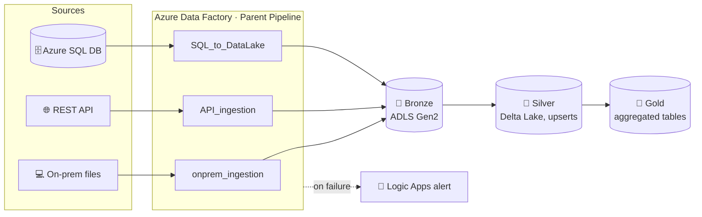

<div align="center">

# ✈️ FlightPath

### An airline data platform built on Azure Data Factory

Airline, flight, passenger and booking data from **three different source types** is ingested into **ADLS Gen2**, refined into a **Delta Lake** silver layer, and served as business-ready **gold** tables, all orchestrated by a single parent pipeline.


</div>

---

## 📌 Overview

Real data rarely comes from one place. FlightPath brings together three sources that each need a different ingestion pattern:

| Source | Data | How it’s ingested |
|---|---|---|
| 💻 **On-premises files** | Airlines, flights, passengers (CSV) | Self-hosted integration runtime + `ForEach` over a parameterized file list |
| 🌐 **REST API** | Airports (JSON) | `Web` activity + `Copy` from an HTTP source |
| 🗄️ **Azure SQL Database** | Bookings (fact) | Incremental load with a JSON-file watermark in the lake |

## 🏗️ Architecture



## ✨ Highlights

- **Dynamic, parameterized pipelines.** One on-prem pipeline loops over a file list (`ForEach`) and applies the right column mapping for each file through object parameters, instead of one pipeline per file.
- **Incremental SQL loads without a watermark table.** Two `Lookup` activities read the last loaded timestamp from a JSON file in the lake and the latest timestamp in the source. Only the rows in between are copied, then the JSON file is updated for the next run.
- **Silver layer with Mapping Data Flows.** Column selection and renaming, derived columns (standardized casing and codes), filtering, type casting, and `Alter Row` upserts into **Delta Lake** tables.
- **Gold layer for the business.** Joins and aggregations on bookings and airlines, with a window ranking to surface the top airlines.
- **Orchestration and alerting.** A parent pipeline runs the three ingestion pipelines, and a `Web` activity calls a **Logic App** that sends an email when something fails.
- **Version control.** The factory is Git-integrated: development happens on `main`, and publishing generates ARM templates on the `adf_publish` branch.

## 📁 Repository structure

```
.
├── pipeline/            # Parent_Pipeline, ingestion pipelines, Silver + Golden layers
├── dataflow/            # DataTransformation (silver), DataServing (gold)
├── dataset/             # parameterized source + sink datasets
├── linkedService/       # ADLS Gen2, Azure SQL, on-prem file system, HTTP
├── integrationRuntime/  # self-hosted IR definition
├── factory/             # factory settings
└── publish_config.json  # publish branch: adf_publish
```

> This repo is the factory’s Git backend, so every pipeline, dataset and data flow is stored as JSON and can be reviewed like code.

## 🚀 Deploy it yourself

1. Create an Azure Data Factory, an ADLS Gen2 account (`bronze`, `silver`, `gold` containers) and an Azure SQL Database.
2. In ADF Studio, open **Manage → Git configuration** and connect this repository (collaboration branch `main`).
3. Install a **self-hosted integration runtime** on the machine that holds the source files.
4. Update the linked services with your own storage account, SQL server and credentials (store secrets in **Azure Key Vault**, never in the repo).
5. Create a Logic App with an HTTP trigger for failure alerts and paste its URL into the parent pipeline’s `Web` activity.
6. Trigger `Parent_Pipeline`, then run the `Silver Layer` and `Golden Layer` pipelines.

## 🧠 What I learned

- Picking the right ingestion pattern for each source instead of forcing one approach.
- Building incremental loads where state lives in the lake itself.
- Writing reusable pipelines with parameters, `ForEach` and `If Condition`.
- Working with ADF as code: Git integration, branches and ARM template publishing.

---

<div align="center">

**Mohammed Alharbi** · Data Engineer

[Portfolio](https://devmohammedalharbi.github.io) · [LinkedIn](https://linkedin.com/in/mohammed-alharbi-1606a7388) · [GitHub](https://github.com/DevMohammedAlharbi)

</div>
